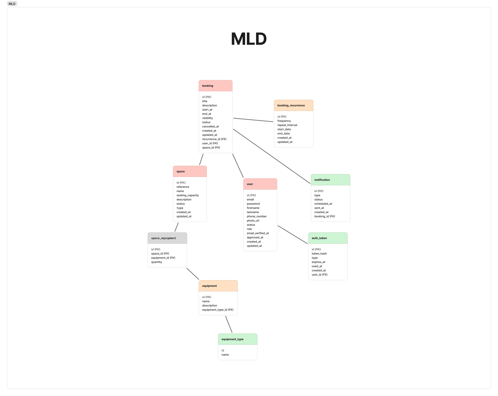

# Documentation — CoWork'Space

Ce dossier regroupe les documents de conception,
les choix techniques et la documentation
du projet CoWork'Space.

## 1. Analyse des besoins

- Cahier des charges
- Fonctionnalités
- Règles de gestion

## 2. Conception fonctionnelle

- Diagramme de cas d'utilisation
- Acteurs et fonctionnalités principales

## 3. Modélisation des données

La modélisation des données permet de définir
les entités, leurs relations et la structure
de la future base de données.

### Modèle Conceptuel de Données (MCD)

### Modèle Logique de Données (MLD)

### Document collaboratif

[MCD et MLD — FigJam](https://www.figma.com/board/skaVQQVAnksYkEmm584QWI/MCD-MLD?node-id=0-1&t=uAQMQOh1TPQJZuly-1)

Les modèles sont actuellement en version 1.
Ils constituent une base de travail à valider
collectivement et à adapter en fonction du cahier
des charges, des fonctionnalités et des maquettes.

## 4. Maquettes

- Wireframes des écrans principaux
- Maquettes de l'application

Lien Figma : à compléter.

## 5. Choix techniques

- Technologies frontend
- Technologies backend
- Base de données
- Architecture logicielle
- Justification des choix techniques

## 6. Tests

- Tests unitaires de la logique métier critique
- Scénario de test utilisateur :
  inscription jusqu'à la réservation

## 7. Suivi des livrables

| Livrable | Statut |
| --- | --- |
| Cahier des charges | En cours |
| Diagramme de cas d'utilisation | À réaliser |
| MCD | V1 - À valider |
| MLD | V1 - À valider |
| Maquettes | En cours |
| Choix techniques | À définir |
| Tests unitaires | À réaliser |
| Scénario de test | À réaliser |

## Liens utiles

- [Trello](https://trello.com/b/vE5fB6EH/coworkspace)
- [Figma - Maquettes](LIEN_FIGMA)
- [FigJam - MCD et MLD](https://www.figma.com/board/skaVQQVAnksYkEmm584QWI/MCD-MLD?node-id=0-1&t=uAQMQOh1TPQJZuly-1)
